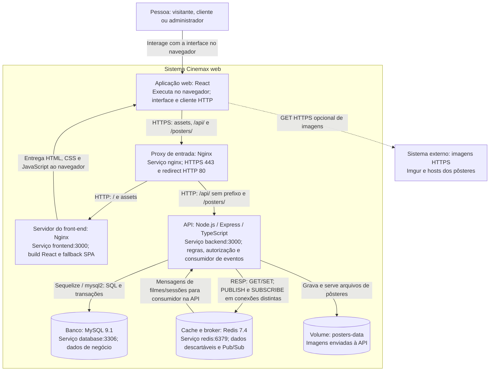

# C4 — Nível 2: containers

## Visão da execução

Este diagrama detalha o sistema do [nível 1](C4_CONTEXTO.md), tomando como
referência o [Compose principal](../../docker-compose.yml). No C4, container é
uma unidade executável ou de armazenamento; a SPA executa no navegador, embora
seu build seja distribuído pelo serviço Docker `frontend`.

**Legenda:** a fronteira reúne o software e seus armazenamentos; a SPA fica
fisicamente no dispositivo do usuário. Setas indicam requisições, entrega do
build ou eventos; respostas HTTP/SQL não são repetidas. Redis não é um processo
de negócio separado: o consumidor executa no mesmo processo Express.

## Responsabilidades e comunicações

| Elemento | Responsabilidade e comunicação real | Fonte |
| --- | --- | --- |
| React | Navegação, formulários e `fetch`; envia Bearer JWT quando existe sessão em `localStorage`. URL de API definida no build; Compose usa `/api` | [Cliente HTTP](../../Projeto-front-end/src/services/api.ts), [sessão](../../Projeto-front-end/src/context/AuthContext.tsx) |
| Proxy Nginx | TLS 1.2/1.3, cabeçalhos de segurança, HTTP 301 para HTTPS; `/api/` remove o prefixo, `/posters/` mantém o caminho | [Configuração](../../nginx.conf) |
| Nginx do frontend | Serve build estático na porta interna 3000; `try_files` retorna `index.html` para rotas da SPA | [Dockerfile](../../Projeto-front-end/Dockerfile), [servidor estático](../../Projeto-front-end/nginx.conf) |
| Express | Rotas REST/JSON, autenticação, autorização, regras nos controllers e persistência nos models; inicia consumidor operacional de eventos | [App](../../Projeto-back-end/src/app.ts), [servidor](../../Projeto-back-end/src/server.ts) |
| MySQL | Fonte de verdade de usuários, clientes, filmes, salas, assentos, sessões, ingressos e pagamentos; volume `mysql-data` | [Models](../../Projeto-back-end/src/models), [conexão](../../Projeto-back-end/src/config/database/index.ts) |
| Redis | Cache de listas, páginas e detalhes de filmes/sessões; canais Pub/Sub de alterações dessas entidades, sem persistência Redis | [Cache](../../Projeto-back-end/src/services/catalogCache.ts), [eventos](../../Projeto-back-end/src/services/catalogEvents.ts) |
| Volume de pôsteres | Persistência de arquivos, independente das imagens Docker; caminho padrão `uploads/posters` | [Upload](../../Projeto-back-end/src/middlewares/posterUpload.ts), [controller](../../Projeto-back-end/src/controllers/posters.controller.ts) |

## Fronteiras operacionais

- Apenas o proxy publica 80/443 para acesso geral. A API também publica
  `127.0.0.1:3000` para acesso local direto, que contorna TLS e cabeçalhos do proxy.
  MySQL e Redis não publicam portas no host no Compose principal.
- `app-network` conecta proxy, servidor estático, API e banco. `cache-network`
  é interna e conecta somente API e Redis. TLS termina no proxy; HTTP interno,
  conexão MySQL com `ssl: false` e Redis `redis://` não são criptografados nessa
  configuração. Isolamento de rede não equivale a criptografia.
- O backend aguarda MySQL saudável e executa ajustes de schema e `sequelize.sync`
  antes de ouvir HTTP. Redis não bloqueia a inicialização HTTP. Existem
  healthchecks nos cinco serviços, mas o da API consulta `/` e o do proxy executa
  `nginx -t`; não comprovam a saúde de todos os fluxos de negócio.
- Cache-aside e Pub/Sub usam o mesmo Redis, mas conexões independentes. A API
  invalida cache diretamente após mutações; o consumidor Pub/Sub apenas valida
  e registra mensagens. Ele não invalida o cache nem processa pagamentos.
- A aplicação tem um backend no Compose. Não há balanceamento entre réplicas,
  cluster Redis, réplica MySQL ou recuperação automática de dados comprovada.
- O [Compose legado de E2E](../../docker-compose.test.yml) é outro ambiente:
  não declara Redis. Este diagrama não deve ser interpretado como sua topologia.
  A integração Redis documentada usa o Compose principal em projeto isolado.

O ambiente exige variáveis locais e um par TLS correspondente. Procedimentos,
volumes e evidências anteriores constam em [Infraestrutura Docker](../INFRAESTRUTURA_DOCKER.md).
