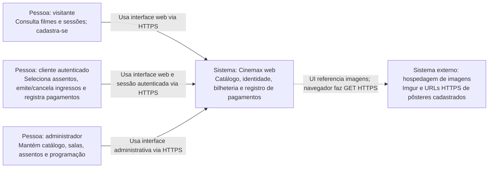

# C4 — Nível 1: contexto do sistema

## Escopo e responsabilidades

O **Cinemax web** permite consultar filmes e sessões, cadastrar/autenticar
usuários, manter o perfil de cliente, selecionar assentos, emitir e cancelar
ingressos, registrar pagamentos e consultar compras. Administradores mantêm
filmes, pôsteres, salas, assentos e sessões. O contexto abaixo descreve o sistema
existente, não uma distribuição em microsserviços.

**Legenda:** pessoas estão fora da fronteira do software; o nó Cinemax concentra
os componentes internos detalhados no [nível 2](C4_CONTAINERS.md). A seta
tracejada indica dependência opcional de conteúdo externo, não uma chamada do
back-end. As respostas retornam pelo mesmo canal de cada requisição.

## Pessoas e fronteira

| Pessoa | Capacidades observadas | Fonte |
| --- | --- | --- |
| Visitante | Catálogo público de filmes, sessões e assentos; cadastro e login | [Rotas](../../Projeto-back-end/src/app.ts) |
| Cliente autenticado | Perfil próprio, ocupação, ingressos, cancelamento, pagamentos e compras próprias | [Ingressos](../../Projeto-back-end/src/controllers/ingressos.controller.ts), [compras](../../Projeto-back-end/src/controllers/compras.controller.ts) |
| Administrador | CRUD administrativo e consultas protegidas por papel | [Rotas](../../Projeto-back-end/src/app.ts), [autorização](../../Projeto-back-end/src/middlewares/auth.middleware.ts) |

O model `User` também admite `funcionario`, mas `requireAdmin` aceita somente
`admin`. Não se presume um portal ou privilégios especiais de funcionário.

## Integrações externas e exclusões

- **Imagens:** [Produtos](../../Projeto-front-end/src/pages/Produtos.jsx),
  [Home](../../Projeto-front-end/src/pages/Home.jsx) e a
  [lista administrativa](../../Projeto-front-end/src/pages/AdminFilmesList.tsx)
  usam `poster_url` ou uma imagem substituta no Imgur. O navegador pode buscar
  essas URLs; imagens enviadas ao Cinemax são servidas localmente por `/posters/`.
  A indisponibilidade do host externo pode afetar a imagem, sem substituir o
  catálogo no MySQL. Não foi testada a disponibilidade desses hosts nesta etapa.
- **Fontes declaradas:** o [HTML](../../Projeto-front-end/public/index.html)
  referencia Google Fonts. No Compose principal, a
  [CSP do proxy](../../nginx.conf) restringe estilos e fontes à própria origem
  (com estilo inline permitido), portanto essa dependência declarada pode ser
  bloqueada. Não é representada como integração operacional garantida.
- **Pagamentos:** [a tela](../../Projeto-front-end/src/pages/Pagamento.jsx)
  chama a API interna; [o controller](../../Projeto-back-end/src/controllers/pagamentos.controller.ts)
  grava método e valor no MySQL. As opções Pix, cartão e dinheiro **não comprovam
  liquidação financeira**; não há gateway, banco externo ou webhook implementado.
- Autenticação é interna (bcrypt/JWT); não há provedor de identidade externo,
  envio de e-mail ou serviço externo de notificações nos fluxos analisados.
- MySQL e Redis são componentes internos, não sistemas externos de negócio.
  GitHub Actions pertence ao ciclo de desenvolvimento, não à execução dos casos
  de uso. O módulo mobile anterior não foi incluído nem modificado.
