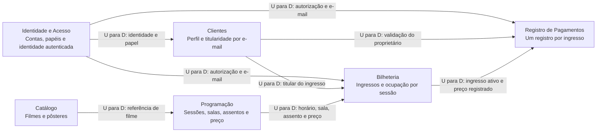

# DDD — análise estratégica e modelo tático

## Natureza da análise

O domínio é a **operação de um cinema com venda de ingressos**. Este documento
aplica DDD como instrumento de análise do código, sem afirmar que o projeto já
implementa DDD integralmente. Os Bounded Contexts abaixo são **fronteiras
conceituais propostas** para organizar significados e responsabilidades.

Hoje existe uma API monolítica, um schema MySQL e acesso direto a models de
outras áreas. Não há pacotes por Bounded Context, contratos remotos entre eles,
repositories de domínio ou classes explícitas de Value Objects e Aggregates.

## Domínios, subdomínios e Bounded Contexts

A classificação núcleo/suporte/genérico é uma interpretação arquitetural desta
entrega, não resultado de entrevistas ou validação formal com especialistas.

| Subdomínio | Categoria proposta | Bounded Context conceitual | Responsabilidade e correspondência atual |
| --- | --- | --- | --- |
| Venda e ocupação | Núcleo | Bilheteria | Emitir/cancelar ingresso, validar assento e horário, consultar ocupação; `Ingresso`, `ingressos.controller.ts` |
| Acervo de filmes | Suporte | Catálogo | Dados de filmes e pôsteres; `Filme`, `filmes.controller.ts`, `posters.controller.ts` |
| Programação e estrutura de exibição | Suporte | Programação | Sessões, preço, sala e mapa de assentos; `Sessao`, `Sala`, `Assento` e respectivos controllers |
| Cadastro de público | Suporte | Clientes | Perfil de cliente usado nas compras, CPF e contatos; `Cliente`, `clientes.controller.ts` |
| Registro financeiro da compra | Suporte | Registro de Pagamentos | Registrar método e valor de um ingresso; `Pagamento`, `pagamentos.controller.ts` |
| Autenticação e autorização | Genérico | Identidade e Acesso | Conta, credenciais e papel; `User`, `auth.controller.ts`, `users.controller.ts` e middleware JWT |

Cache, broker, proxy, CI e containers são mecanismos técnicos transversais, não
subdomínios de negócio nem Bounded Contexts adicionais.

## Linguagem ubíqua e limites semânticos

| Termo | Significado observado e limite |
| --- | --- |
| Usuário | Conta autenticável em `usuarios`; possui senha com hash e papel. Não é o mesmo model que Cliente |
| Cliente | Perfil em `clientes`, vinculado à conta por e-mail normalizado na lógica atual; sem referência explícita de usuário no model |
| Sessão | Exibição de um filme numa sala, em determinado horário, com preço inteiro |
| Assento | Lugar físico da sala; não possui estado global de ocupado |
| Ocupação | Ingresso ativo para o par sessão/assento; é derivada dos ingressos |
| Ingresso | Direito registrado para cliente, sessão e assento, com tipo, snapshot de preço e status ativo/cancelado |
| Pagamento | Registro interno por ingresso com método e valor; não comprova cobrança Pix/cartão em instituição financeira |
| Compra | Visão composta de ingressos e pagamentos de um cliente; não existe model/tabela `Compra` nem pedido agregado implementado |

O estado `ativo` do ingresso representa ocupação inclusive quando ainda não há
pagamento. Não há expiração automática de uma reserva temporária. Cancelar
preserva o ingresso e libera a ocupação ativa; não executa estorno externo.

## Context Map conceitual

**Legenda:** cada nó é um Bounded Context conceitual. A seta vai do fornecedor
**upstream (U)** ao consumidor **downstream (D)** de informação/regra; não é uma
chamada HTTP nem evento Redis. Identidade também protege a administração de
Catálogo e Programação pelas rotas, omitida nas setas para legibilidade.

### Relacionamentos e integração existentes

| Relação | Integração observada | Interpretação/limite DDD |
| --- | --- | --- |
| Identidade → Clientes/Bilheteria/Pagamentos | JWT verificado por middleware, `req.authUser`, e-mail comparado com perfil | Dependência de identidade compartilhada; não há provedor externo nem ACL de domínio implementada |
| Catálogo → Programação | `Sessao.id_filme`; validação por `Filme.findByPk` | Programação consome a identidade do filme diretamente do model compartilhado |
| Programação → Bilheteria | Consultas de sessão/assento, bloqueio da sessão e snapshot do preço | Bilheteria depende das regras de horário e sala; não usa uma API interna encapsulada |
| Clientes → Bilheteria/Pagamentos | `id_cliente` e comparação do e-mail do perfil com o JWT | Titularidade é acoplada ao e-mail; não há vínculo por identificador de conta no model Cliente |
| Bilheteria → Pagamentos | Consulta/bloqueio de Ingresso; valida status e `valor_unitario` | Pagamentos depende do estado do ingresso e compartilha sua transação no mesmo banco |

O relacionamento atual se aproxima de **modelo e persistência compartilhados**,
sem um Shared Kernel formalmente governado. As setas U/D indicam dependência
semântica; não provam acordos Customer/Supplier, Open Host Service ou Published
Language entre equipes. Como evolução conceitual, contratos de aplicação com
identificadores e snapshots poderiam reduzir esse acoplamento; não foram criados.

`ComprasController` oferece uma consulta transversal: compõe Cliente, Ingresso,
Pagamento, Sessao, Filme, Assento e Sala. É uma projeção de leitura calculada,
sem armazenamento próprio e sem comprovar implementação de CQRS.

Eventos Redis de filmes e sessões servem ao log operacional. O código não os usa
para integrar estes Bounded Contexts; não há evento de ingresso/pagamento ou
consumidor de negócio adicional.

## Modelo tático conceitual de Bilheteria

### Entities e referências

| Elemento | Tipo na modelagem | Identidade e estado | Situação no código |
| --- | --- | --- | --- |
| Ingresso | Entity do contexto | `id_ingresso`; cliente, sessão, assento, tipo, valor, status e datas | Model Sequelize existente, sem encapsulamento das regras no objeto |
| Sessão de exibição | Referência externa a Programação | `id_sessao`, horário, sala e preço vigente | Consultada diretamente; o lock da sessão serializa operações críticas |
| Assento físico | Referência externa a Programação | `id_assento`, sala, fila e número | Consultado para validar a sala; ocupação pertence à Bilheteria |
| Titular | Referência externa a Clientes | `id_cliente` e e-mail de titularidade | Consultado dentro dos casos de uso |
| Pagamento | Entity de outro contexto | `id_pagamento` e `id_ingresso` | Não integra o Aggregate de Bilheteria proposto |

### Value Objects candidatos

Não há classes de Value Objects no projeto. Os nomes abaixo identificam valores
que poderiam encapsular regras já distribuídas por validações e campos primitivos.

| Value Object proposto | Valores e igualdade | Regra e correspondência atual |
| --- | --- | --- |
| Preço do ingresso | Quantidade em centavos; igualdade pelo valor | Não negativo; controller deriva preço da sessão e arredonda meia; armazenamento `DECIMAL(6,2)` |
| Tipo de ingresso | `inteira` ou `meia`; igualdade pela opção | Rejeita tipos não reconhecidos; lote distribui quantidades validadas |
| Estado do ingresso | `ativo` ou `cancelado`; igualdade pelo estado | Transição de cancelamento exige sessão futura e grava `cancelado_em` |
| Referência de lugar na sessão | Par `(id_sessao, id_assento)` | Identifica a ocupação lógica; no máximo um ingresso ativo para o par |

Esses objetos seriam imutáveis por proposta. O código existente utiliza números,
strings, datas e models mutáveis. Não se presume Value Object implementado por
um campo SQL ser `ENUM` ou `DECIMAL`.

### Aggregate proposto

**Aggregate Ingresso**, com **Ingresso como Aggregate Root**, reúne a identidade,
referências ao cliente/sessão/assento, tipo, snapshot de preço, estado e datas.
As referências externas não transferem a propriedade de Cliente, Sessao ou
Assento para esse agregado. Ingresso é a única Entity interna necessária neste
recorte; os demais elementos internos são valores.

Invariantes pretendidas e seus mecanismos atuais:

1. **Emissão autorizada:** o cliente informado pertence ao e-mail autenticado;
   a sessão existe e ainda não começou; o assento pertence à sala.
2. **Snapshot de preço:** a API calcula o valor pela sessão, preservando-o no
   ingresso; o pagamento posterior usa esse snapshot, não o preço do navegador.
3. **Ocupação exclusiva:** no máximo um ingresso ativo por sessão/assento. Essa
   regra abrange vários agregados conceituais; hoje é protegida por transação,
   lock da sessão e índice único, não por um método da Entity isoladamente.
4. **Cancelamento:** somente pelo titular e antes do início; o histórico permanece.
   A operação não apaga o ingresso nem o pagamento previamente registrado.
5. **Emissão em lote:** 1 a 10 assentos distintos com quantidades inteira/meia
   coerentes; todos são criados na mesma transação ou a transação falha.

O limite proposto não deve ser confundido com limite transacional já isolado.
Os controllers atuais consultam/bloqueiam dados de outros contextos. Criar um
lote não cria uma Entity Compra; pagar vários ingressos usa chamadas individuais
e pode ter sucesso parcial. No contexto de pagamentos, um Aggregate Pagamento
com raiz própria seria um candidato adicional; não foi implementado nesta etapa.

## Rastreabilidade

- [Models](../../Projeto-back-end/src/models) e [DER](../DER.md): dados persistidos.
- [Ingressos](../../Projeto-back-end/src/controllers/ingressos.controller.ts) e
  [índice ativo](../../Projeto-back-end/src/utils/ensureIngressosSchema.ts): invariantes.
- [Clientes](../../Projeto-back-end/src/controllers/clientes.controller.ts),
  [middleware](../../Projeto-back-end/src/middlewares/auth.middleware.ts): titularidade.
- [Programação](../../Projeto-back-end/src/controllers/sessoes.controller.ts),
  [geração de assentos](../../Projeto-back-end/src/controllers/salasAssentos.controller.ts).
- [Pagamentos](../../Projeto-back-end/src/controllers/pagamentos.controller.ts),
  [consulta de compras](../../Projeto-back-end/src/controllers/compras.controller.ts),
  [pagamento na UI](../../Projeto-front-end/src/pages/Pagamento.jsx).
- [ADR-002](adrs/ADR-002-organizacao-backend.md) e
  [ADR-003](adrs/ADR-003-mysql-sequelize.md): distância entre módulos técnicos e domínio.
